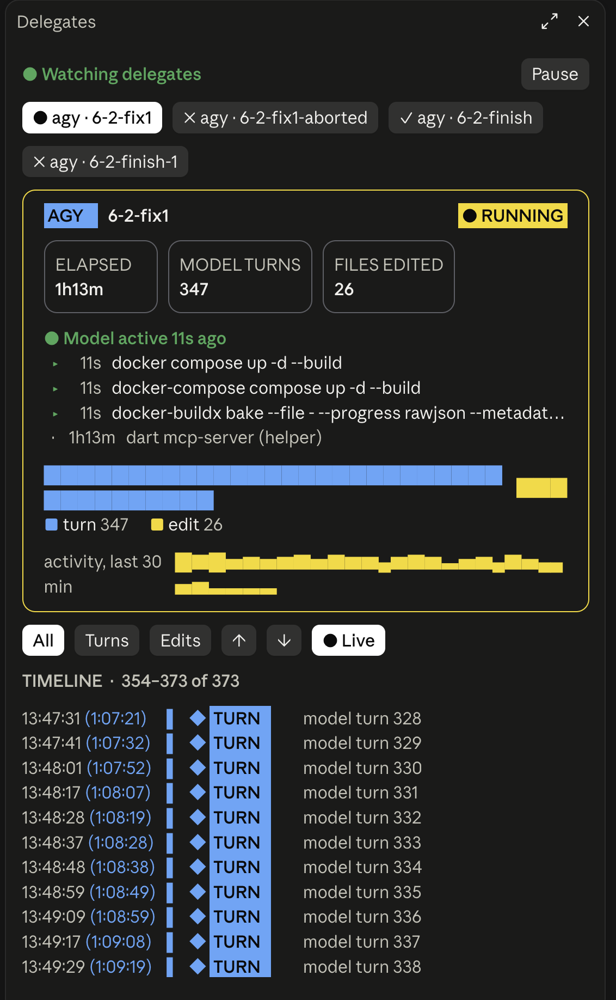

# delegate-watch

A live pane for [Claude Code](https://claude.com/claude-code) that shows what your delegated coding
agents are doing **while they work**, instead of leaving you blind until they finish.

It watches runs started by relay-style delegate scripts for **agy** (Google Antigravity),
**Claude Code** (`claude -p`), **cursor-agent** and **opencode**, and works in both the terminal CLI and the desktop app.

It is built around the run folders written by the [delegate-skills](https://github.com/amElnagdy/delegate-skills)
relay scripts (`/agy-delegate`, `/claude-delegate`, `/cursor-delegate`, `/opencode-delegate`). Install those skills to get runs
to watch; this plugin only reads what they write.

## What you see



- A chip per recent run (● running, ✓ done, ✗ failed), newest first.
- A status card: agent badge, model, elapsed time, tool calls or model turns, files edited, cost.
- A tool-mix bar and a 30-minute activity strip.
- A timeline of every event: clock time, time since the run started `(01:38)`, a typed badge
  (READ, EDIT, SHELL, GREP, TURN, THINK...), and the file or command (folder dimmed, name bold).
- Filters (All / Tools / Thoughts, or Turns / Edits for agy), scroll buttons and a Live toggle.
- A toast when a run finishes and a status-line count of running delegates.

### Per agent

| Agent | Source | What is shown |
| --- | --- | --- |
| Claude Code | `events.jsonl` (stream-json) | every tool call, message, visible thought, failed tool result, and the run's cost |
| cursor-agent | `events.jsonl` (stream-json) | every tool call, message and thought |
| opencode | `events.jsonl` | every tool call, message, error, and cost |
| agy | `agy.log`, `stderr.txt`, `git`, `ps` | model turns, files it edited since start, idle/blocked state, commands running under agy |

agy writes no event stream, so for agy the pane infers progress from the outside: each
`streamGenerateContent` request in its log is a model turn, files changed in the working tree since
the run started are its edits, and `ps` shows what it is waiting on. It cannot show agy's tool calls
or reasoning.

## Install

```
/plugin install delegate-watch --marketplace EslamHanafy/delegate-watch
```

Or from a shell:

```bash
claude plugin marketplace add EslamHanafy/delegate-watch
claude plugin install delegate-watch@delegate-watch --scope user
```

## Use

- The pane opens by itself when a new run starts. Reopen it with `/delegate-watch`.
- `/delegate-watch pause` and `/delegate-watch resume` stop and restart all polling. The choice is
  remembered across sessions. The Pause / Resume button in the pane does the same.
- Closing the pane only hides it; polling continues until you pause.

## Configure where it looks

Run folders live in different places depending on how you dispatch delegates, so the search folders
are settings, not hard-coded. The defaults match the delegate relay scripts:

| Setting | Default | Meaning |
| --- | --- | --- |
| `watchPaths` | `$TMPDIR/delegate-relay`, `.orchestrator`, `.superpowers` | Folders to search for run folders. Absolute, or relative to the folder Claude Code was started in. `$TMPDIR` and `~` are expanded. |
| `searchDepth` | `6` | How many folder levels below each watched folder to search. |
| `maxAgeHours` | `6` | Only runs whose log changed within this many hours are shown. |
| `maxSessions` | `3` | How many of the most recent runs get a chip at the top of the pane (1 to 12). |
| `timelineRows` | `8` | How many timeline events show at once. `0` fits the pane height. The − / + buttons in the pane change it live and remember the choice. More rows cost a little more drawing per refresh, nothing else. |

In the pane itself, the **− / +** buttons next to the timeline filters change the number of timeline
rows by 5 (down to `auto`, which fits the pane height). That choice is remembered across sessions and
takes priority over `timelineRows`. Long thinking and message rows end in `▸`; press it to read the full
text, `▾` to fold it again. The tool-mix bar always spans the full pane width, with bar widths
square-root scaled so small groups stay visible (the legend shows exact counts and percentages).

Change them any of these ways:

- The `/config` menu in Claude Code (each setting is a row under `delegate-watch`), or the prompt shown
  when you install the plugin.
- `claude plugin configure delegate-watch@delegate-watch`.
- Directly in `~/.claude/settings.json`:

```json
{
  "pluginConfigs": {
    "delegate-watch": {
      "watchPaths": ["$TMPDIR/delegate-relay", ".my-runs", "~/agent-runs"],
      "searchDepth": 4,
      "maxAgeHours": 24,
      "timelineRows": 30
    }
  }
}
```

Changes apply on the next `/reload-plugins` (or new session).

### What counts as a run

Any folder under a watched path that contains `events.jsonl` (Claude Code, cursor-agent, opencode) or `agy.log`
(agy). The pane also reads `result.json`, `final.txt`, `brief.txt` and `stderr.txt` in that folder
when present. If your delegate scripts write somewhere else, point `watchPaths` at it. Start Claude
Code in the project whose delegates you want to watch, so relative paths resolve there.

## Cost and performance

No model calls and no tokens. It polls every 2 seconds (10 seconds when nothing is running), reads
only the bytes added since the last poll of the selected run, and caps memory at 4,000 events per
run. The `find`, `git` and `ps` calls run every 6 to 8 seconds, `git` and `ps` only for a running agy
run.

## Safety and privacy

Everything is local. It reads log files and runs `find`, `tail`, `head`, `stat`, `git ls-files`,
`pgrep` and `ps`. It makes no network requests and sends nothing anywhere. The only thing it stores
is the pause flag. The pane shows your delegates' output, which can contain code, paths and prompts,
so treat screenshots accordingly. As with any plugin, read the code before installing; it is
`delegate-watch/hooks/`.

## Platforms

macOS and Linux. Windows is not supported (it relies on `sh`, `find`, `xargs`, `ps`).

## Development

```bash
claude plugin validate delegate-watch
claude plugin test delegate-watch
```

After editing, run `/reload-plugins`. Bump the version in `delegate-watch/.claude-plugin/plugin.json`
and `.claude-plugin/marketplace.json` for each release so installed copies update.

## License

MIT
